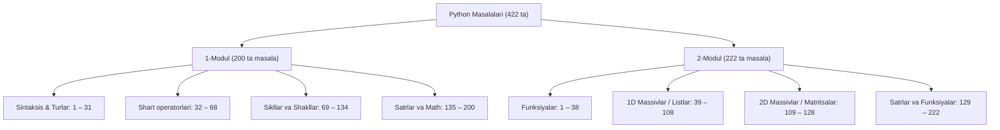

# 📚 Python Masalalari Umumiy Mundarijasi (Modul 1 va Modul 2)

Ushbu papkada **Modul 1** (200 ta masala) va **Modul 2** (222 ta masala) bo‘yicha jami **422 ta masala**ning mavzular kesimidagi to‘liq xaritasi keltirilgan.

---

## 🗺️ Umumiy Taqsimot Xaritasi

---

## 📑 Modullar bo‘yicha havolalar

1. **[1-Modul Masalalar Mundarijasi](file:///home/shamsiddin/Documents/SCARPION/Masalalar/Python/Masalalar/Modul%201/Masala%20fayl/README.md)**
   - Sintaksis, o‘zgaruvchilar, arifmetika: `1 – 31`
   - Shart operatorlari (`if/elif/else`): `32 – 68`
   - Sikllar (`for`, `while`, shakllar, EKUB/EKUK): `69 – 134`
   - Satrlar (String) va Math: `135 – 200`

2. **[2-Modul Masalalar Mundarijasi](file:///home/shamsiddin/Documents/SCARPION/Masalalar/Python/Masalalar/Modul%202/Masala%20fayl/README.md)**
   - Funksiyalar (`def`): `1 – 38`
   - Bir o‘lchovli massivlar (List): `39 – 108`
   - Matritsalar (2D Massivlar): `109 – 128`
   - Satrlar va ilg‘or funksiyalar: `129 – 222`
